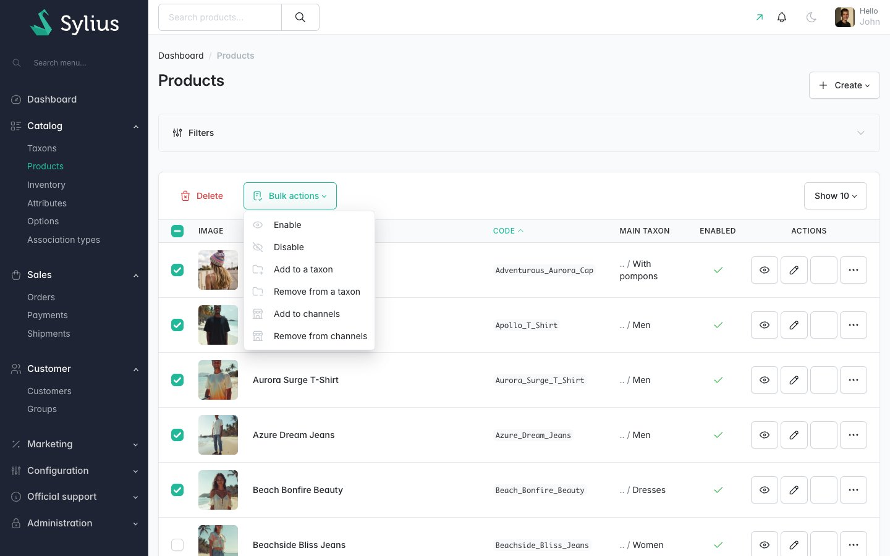
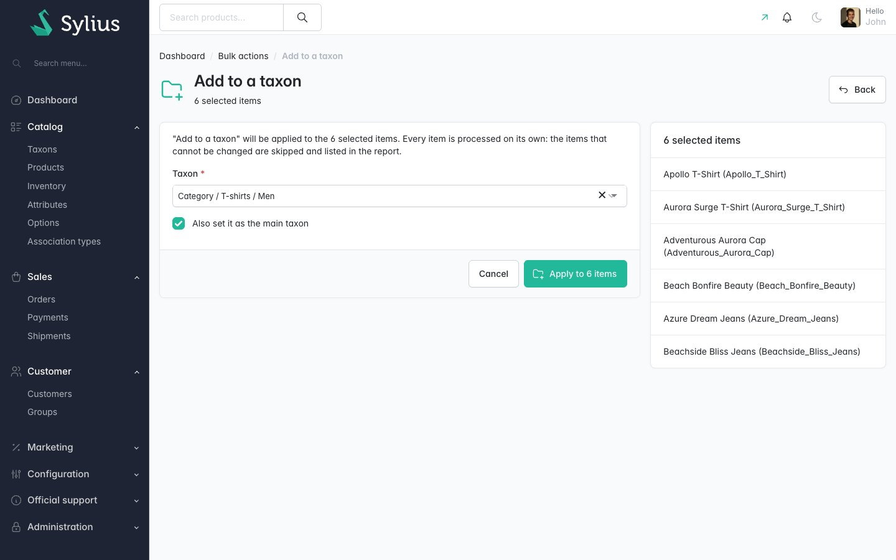
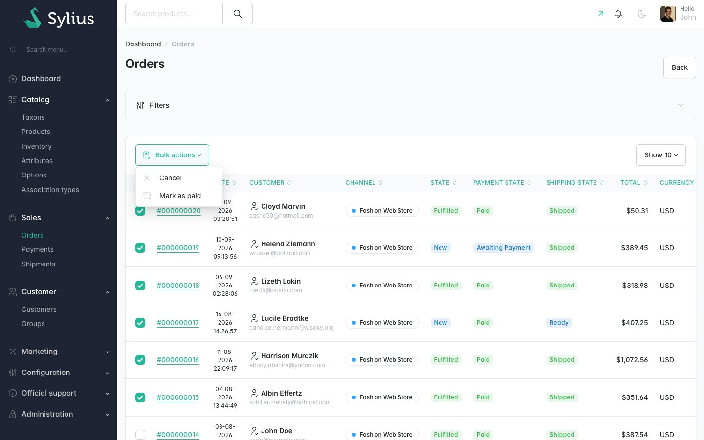
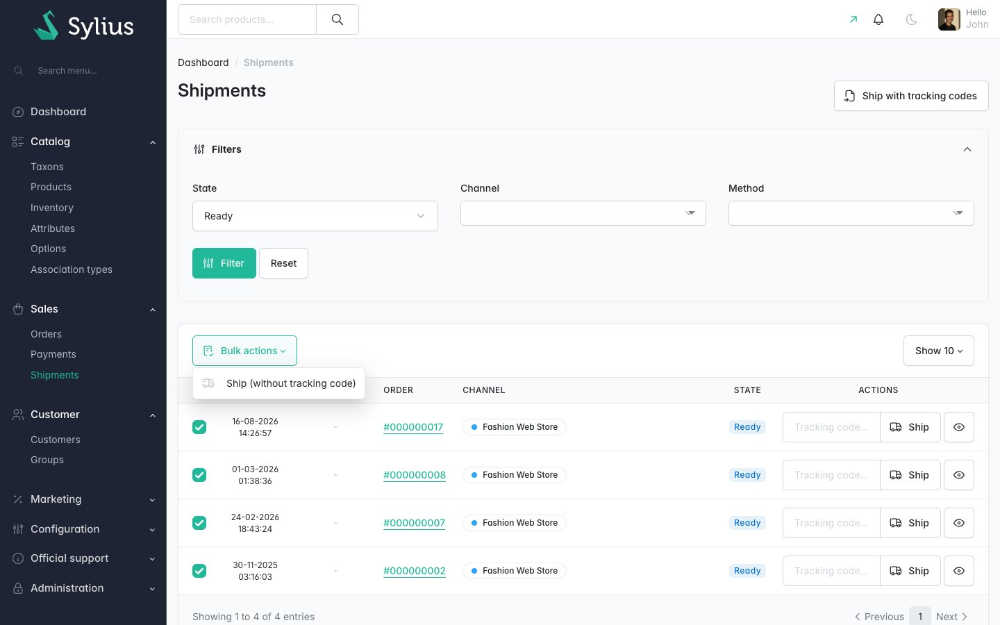
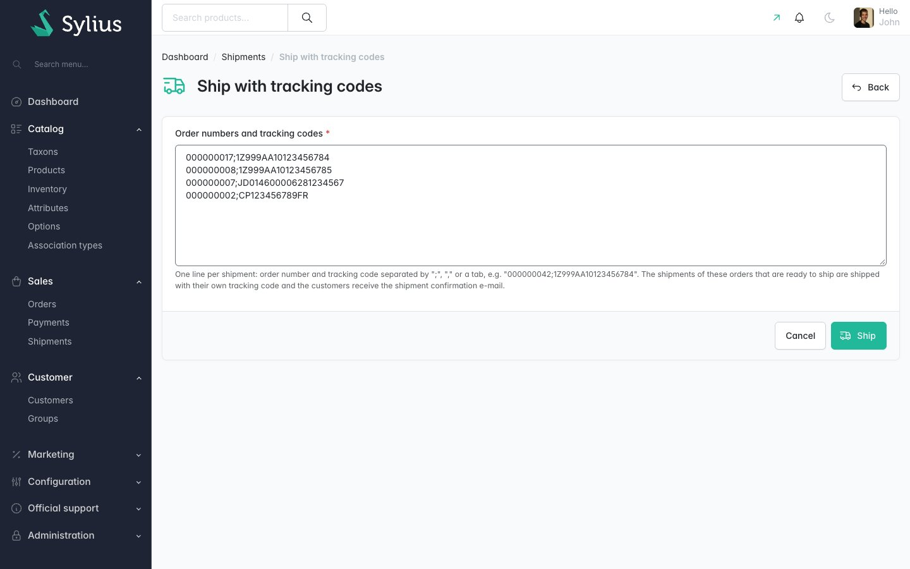
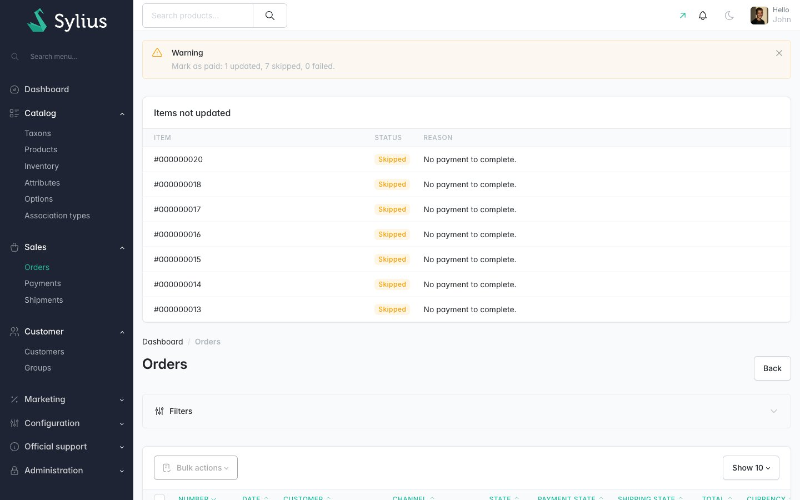

# Plugin Sylius Bulk Actions

> English: [README.md](README.md) <!-- vitrine:lang -->

[](https://github.com/thibmonier/sylius-bulk-actions-plugin/actions/workflows/build.yaml)
[](LICENSE)

**Actions groupées pour les grilles de l'administration Sylius 2 : produits, commandes, paiements, expéditions et clients.**

Les grilles de l'administration Sylius 2 ne savent que supprimer en masse. Désactiver 40 produits, annuler un lot de commandes
impayées, marquer des virements bancaires comme payés ou expédier les colis du matin impose encore
d'ouvrir chaque élément. Les plugins d'actions groupées de Sylius 1 n'ont jamais été portés vers Sylius 2.

Ce plugin ajoute un menu *Actions groupées* aux grilles. Sélectionnez des lignes, choisissez une action, confirmez, et
obtenez un rapport de ce qui a été modifié, de ce qui a été ignoré et pourquoi. Il est gratuit et open source.

## Fonctionnalités

| Grille | Actions groupées |
|---|---|
| Produits | Activer / désactiver ; ajouter à une catégorie (éventuellement comme catégorie principale) / retirer d'une catégorie ; ajouter à des canaux / retirer de canaux |
| Variantes de produit | Activer / désactiver |
| Commandes | Annuler ; marquer comme payée (finalise le paiement en cours) |
| Paiements | Marquer comme payé (transition `complete`) |
| Expéditions | Expédier (sans numéro de suivi) ; **expédier avec numéros de suivi** : collez des lignes `order number;tracking code` pour expédier plusieurs commandes, chacune avec son propre numéro de suivi |
| Clients | Affecter à un groupe / retirer de leur groupe ; activer / désactiver le compte boutique |

Fonctionnement :

- **Même comportement que l'action unitaire de l'administration.** Les changements d'état passent par l'abstraction de machine
  à états de Sylius (`can()` d'abord, puis `apply()`), et le plugin dispatche les mêmes
  événements de ressource que les boutons de l'administration (`sylius.shipment.pre_ship` / `post_ship`,
  `sylius.payment.pre_complete` / `post_complete`, `sylius.order.pre_update` / `post_update`,
  `sylius.product.pre_update` / `post_update`...). Ainsi l'e-mail de confirmation d'expédition est envoyé,
  la vérification du stock avant la finalisation d'un paiement s'exécute, les promotions de catalogue sont rafraîchies et l'annulation
  d'une commande annule toujours les paiements, les expéditions et les réservations de stock.
- **Chaque élément est traité séparément.** Un élément qui ne peut pas être modifié est *ignoré* avec une raison
  (transition non autorisée, déjà désactivé, une variante n'a pas de prix dans le canal, client invité
  sans compte...). Un élément qui lève une exception est en *échec* et les autres éléments sont tout de même traités.
- **Rapport clair.** Un message flash affiche *« Annuler : 18 modifié(s), 2 ignoré(s), 0 en échec. »*, et un tableau
  en dessous liste chaque élément ignoré ou en échec avec sa raison.
- **Sûr.** La page de confirmation est protégée contre le CSRF et réservée aux administrateurs. Elle affiche
  les éléments sélectionnés et le formulaire de l'action (sélecteur de catégorie, canaux, groupe de clients). Une requête
  est plafonnée à 500 éléments par défaut (configurable), avec un message clair au-delà. Les modifications
  sont enregistrées par lots.
- **Extensible.** Implémentez `BulkActionInterface` et votre action apparaît dans la grille de sa
  ressource. Écoutez `tmonier_bulk_actions.post_execute` pour obtenir le rapport.

Également inclus : traductions en anglais, français, allemand, espagnol, italien, néerlandais et polonais ;
Twig Hooks ; aucune table en base de données ; prise en charge de MySQL, MariaDB et PostgreSQL.

## Captures d'écran













## Prérequis

| | Version |
|---|---|
| PHP | 8.2+ |
| Sylius | 2.2, 2.3 |
| Symfony | 6.4, 7.4, 8.0 |

Les transitions sont appliquées via `Sylius\Abstraction\StateMachine\StateMachineInterface`, de sorte que
l'adaptateur Symfony Workflow (par défaut dans Sylius 2) comme les graphes mappés Winzou fonctionnent.

## Installation

1. Installez le paquet :

    ```bash
    composer require tmonier/sylius-bulk-actions-plugin
    ```

2. Enregistrez le bundle dans `config/bundles.php` (Symfony Flex le fait automatiquement dès qu'une recette existe) :

    ```php
    Tmonier\SyliusBulkActionsPlugin\TmonierSyliusBulkActionsPlugin::class => ['all' => true],
    ```

3. Importez la configuration dans `config/packages/tmonier_sylius_bulk_actions.yaml` :

    ```yaml
    imports:
        - { resource: "@TmonierSyliusBulkActionsPlugin/config/config.yaml" }
    ```

4. Importez les routes de l'administration dans `config/routes/tmonier_sylius_bulk_actions.yaml` :

    ```yaml
    tmonier_sylius_bulk_actions:
        resource: "@TmonierSyliusBulkActionsPlugin/config/routes.yaml"
    ```

Il n'y a pas de migration : le plugin n'a pas de table.

## Configuration

```yaml
# config/packages/tmonier_sylius_bulk_actions.yaml
tmonier_sylius_bulk_actions:
    max_items: 500     # items per bulk request (default 500)
    batch_size: 50     # items changed between two flushes (default 50)
    actions:           # every action is enabled by default
        order_cancel: { enabled: false }
        customer_disable_account: false
```

Codes d'action : `product_enable`, `product_disable`, `product_add_taxon`, `product_remove_taxon`,
`product_add_channels`, `product_remove_channels`, `product_variant_enable`,
`product_variant_disable`, `order_cancel`, `order_payment_complete`, `payment_complete`,
`shipment_ship` (également utilisé par la page *Expédier avec numéros de suivi*), `customer_assign_group`,
`customer_remove_group`, `customer_enable_account`, `customer_disable_account`.

Le menu est ajouté aux grilles `sylius_admin_product`, `sylius_admin_product_variant`,
`sylius_admin_order`, `sylius_admin_payment`, `sylius_admin_shipment` et
`sylius_admin_customer` sous la forme d'une action groupée de type `tmonier_bulk_actions`. Pour le retirer d'une
grille, ou n'afficher que certaines actions dans un ordre donné :

```yaml
sylius_grid:
    grids:
        sylius_admin_customer:
            actions:
                bulk:
                    tmonier_bulk_actions:
                        enabled: false
        sylius_admin_order:
            actions:
                bulk:
                    tmonier_bulk_actions:
                        options:
                            resource: sylius.order
                            actions: [order_payment_complete]
```

Le même type d'action groupée fonctionne sur vos propres grilles : définissez `options.resource` avec l'alias de
ressource de la grille (par ex. `app.supplier`).

## Expédier avec des numéros de suivi

Un seul numéro de suivi pour plusieurs colis n'a pas de sens : l'action de la grille expédie donc **sans**
numéro de suivi. Pour expédier avec des numéros de suivi, cliquez sur **Expédier avec numéros de suivi** sur la
page des expéditions et collez une ligne par expédition, par exemple une colonne copiée depuis l'export de votre transporteur :

```
000000042;1Z999AA10123456784
000000043,1Z999AA10123456785
#000000044	COLISSIMO-6A123
```

Le séparateur peut être `;`, `,` ou une tabulation, et un `#` en début de ligne est ignoré. Chaque ligne expédie la prochaine
expédition de la commande qui est prête à partir, avec son propre numéro de suivi, et le client reçoit
l'e-mail de confirmation d'expédition. Répétez le numéro de commande pour expédier une commande ayant plusieurs
expéditions. Les commandes inconnues et les commandes sans rien à expédier sont listées dans le rapport.

## Écrire votre propre action

```php
use Tmonier\SyliusBulkActionsPlugin\Action\BulkActionInterface;
use Tmonier\SyliusBulkActionsPlugin\Action\BulkActionResult;

final class ArchiveSupplierAction implements BulkActionInterface
{
    public function getCode(): string { return 'supplier_archive'; }
    public function getResource(): string { return 'app.supplier'; }      // grid resource
    public function getLabel(): string { return 'app.ui.archive'; }       // messages domain
    public function getIcon(): string { return 'tabler:archive'; }
    public function getFormType(): ?string { return null; }               // or a form type class

    public function supports(object $item): bool { return $item instanceof Supplier; }

    public function execute(object $item, array $data): BulkActionResult
    {
        if ($item->isArchived()) {
            return BulkActionResult::skipped('app.bulk.already_archived'); // flashes domain
        }
        $item->archive();

        return BulkActionResult::applied();
    }
}
```

Avec l'autoconfiguration, le service est enregistré automatiquement. Sinon, taguez-le
`tmonier_bulk_actions.action`. Règles :

- ne faites jamais de flush dans `execute()` : le processeur fait un flush tous les `batch_size` éléments ;
- retournez `skipped()` plutôt que de lever une exception lorsque l'élément ne peut pas être modifié ;
- `getFormType()` retourne un type de formulaire dont les données sont transmises à `execute()` dans `$data` ;
- pour appliquer une transition de machine à états comme le fait l'administration, utilisez
  `TransitionApplierInterface::apply($subject, $graph, $transition, $resourceAlias, $eventName)` ;
  pour dispatcher les événements de ressource autour d'une modification simple, utilisez `ResourceEventDispatcherInterface`.
  L'événement « post » s'exécute une fois le lot enregistré, via `BulkActionResult::applied($afterFlush)`.

Après chaque exécution, `tmonier_bulk_actions.post_execute` est dispatché avec un
`BulkActionExecutedEvent` (action, données, rapport avec le résultat de chaque élément).

## Limitations connues

- La sélection correspond aux lignes cochées de la page courante de la grille. Utilisez le sélecteur
  d'*éléments par page* (jusqu'à 100 dans Sylius par défaut) et les filtres pour les lots plus importants. Il n'existe pas
  d'option « tout sélectionner selon le filtre ».
- Le traitement est synchrone, dans la requête de l'administration. `max_items` le garde borné ; pour des milliers
  d'éléments, utilisez l'API Sylius ou une commande de la console.
- Une erreur de base de données lors d'un flush fait échouer son lot et arrête l'exécution : les éléments restants
  sont signalés comme *en échec*. Les modifications déjà enregistrées sont conservées, il n'y a pas de rollback global.
- *Ajouter à des canaux* ne crée pas de prix : un produit est ignoré lorsque l'une de ses variantes n'a
  pas de prix dans le canal cible.
- Le RBAC de Sylius Plus n'est pas intégré : tout administrateur (`ROLE_ADMINISTRATION_ACCESS`) peut exécuter
  les actions groupées activées. Utilisez la configuration `actions` pour en désactiver certaines.

## Développement

```bash
docker compose up -d mysql   # or your own MySQL
composer install
(cd vendor/sylius/test-application && yarn install && yarn build)
vendor/bin/console doctrine:database:create
vendor/bin/console doctrine:migrations:migrate -n
vendor/bin/console sylius:fixtures:load -n

vendor/bin/phpunit --testsuite unit
APP_ENV=test vendor/bin/phpunit --testsuite non-unit   # needs a test database with fixtures
vendor/bin/phpstan analyse
vendor/bin/ecs check
```

<!-- vitrine:demo-b2b:start -->
## Démo B2B

Ce plugin est utilisé dans la [démo B2B Sylius](https://github.com/thibmonier/sylius-b2b-demo) : une boutique Sylius 2.3 avec des données d'exemple fictives, où les plugins B2B fonctionnent ensemble. Le code source, l'installation et les fixtures de la démo sont dans ce dépôt.

- Démo en ligne : [sylius-b2b.thibaut-monier.fr](https://sylius-b2b.thibaut-monier.fr)
- Auteur : [Thibaut Monier](https://www.linkedin.com/in/thibautmonier/)

La démo est un exemple, pas une configuration de production.
<!-- vitrine:demo-b2b:end -->

## Licence

MIT. Voir [LICENSE](LICENSE).
